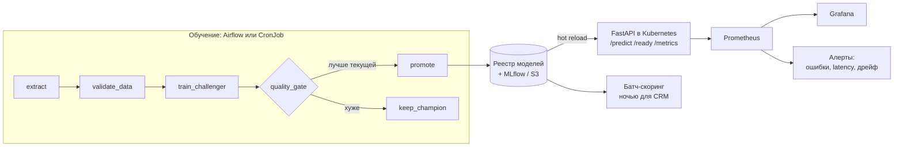

# churn-mlops

Сервис скоринга оттока клиентов с полным MLOps-контуром: модель CatBoost
переобучается по расписанию, проходит проверки данных и ворота качества,
отдаётся через FastAPI в Kubernetes и мониторится в Prometheus и Grafana,
включая дрейф входных данных.

Главная идея проекта: ML-сервис может быть технически здоров и при этом
плохо предсказывать. Поэтому кроме метрик сервиса здесь проверяются данные
и качество модели, а слабая модель не может попасть в прод.

## Архитектура



## Что из стека где

| Инструмент | Где | Что делает |
|---|---|---|
| CatBoost, scikit-learn | `churn/train.py` | Обучение, метрики, сплит по времени |
| Pydantic | `churn/api.py`, `churn/config.py` | Проверка входа API, настройки из env |
| FastAPI | `churn/api.py` | `/predict`, `/predict/batch`, `/health`, `/ready`, `/metrics` |
| Airflow | `airflow/dags/` | Переобучение с воротами качества, батч-скоринг |
| MLflow + S3 (SeaweedFS) + Postgres | `churn/tracking.py`, `docker-compose.yml` | Эксперименты, реестр с алиасом `champion`, артефакты в S3 |
| Docker | `Dockerfile` | Multi-stage, non-root, tini как PID 1 |
| Kubernetes | `k8s/` | Deployment, Service, HPA, PDB, Job, CronJob, PVC, пробы, limits |
| Prometheus, Grafana | `monitoring/` | Метрики сервиса и модели, дашборд, алерты |
| GitHub Actions | `.github/workflows/ci.yml` | Линтер, тесты, сборка образа, smoke-тест, push в GHCR |

## Быстрый старт

### Локально, без Docker

```bash
make install     # окружение и зависимости
make train       # данные + обучение + ворота качества -> модель в проде
make serve       # API на http://localhost:8000, документация на /docs
```

```bash
curl -X POST localhost:8000/predict -H 'Content-Type: application/json' -d @scripts/sample_customer.json
```

### Весь стенд в Docker Compose

```bash
cp .env.example .env
make up          # api, mlflow, s3, postgres, prometheus, grafana
make up-all      # то же + airflow
```

| Сервис | Адрес |
|---|---|
| API и Swagger | http://localhost:8000/docs |
| Grafana (дашборд «Churn scoring») | http://localhost:3000 |
| Prometheus (вкладка Alerts) | http://localhost:9090 |
| MLflow | http://localhost:5001 |
| S3-хранилище (файлы артефактов) | http://localhost:8888 |
| Airflow | http://localhost:8080 (пароль: `docker compose exec airflow cat /opt/airflow/standalone_admin_password.txt`) |

### Kubernetes (Docker Desktop с включённым Kubernetes)

```bash
make k8s-build                        # образ churn-mlops:0.1.0
make k8s-up                           # kubectl apply -k k8s/
kubectl -n churn get pods -w          # Job обучит модель, поды API станут Ready
kubectl -n churn port-forward svc/churn-api 8000:80
```

HPA нужен metrics-server: в Docker Desktop его ставят отдельно.

## Сценарии для демонстрации

**1. Дрейф данных.** Сервис сам считает PSI по каждому признаку на скользящем окне запросов.

```bash
make load      # обычный трафик: PSI по всем признакам < 0.1
make drift     # клиенты моложе, тарифы дороже: PSI взлетает выше 0.2
```

В Grafana панель «Дрейф признаков» уходит в красную зону, через 15 минут срабатывает алерт `ChurnFeatureDrift`.
Ошибок 5xx при этом нет, latency в норме: без мониторинга модели никто бы ничего не заметил.

**2. Слабая модель не попадает в прод.** Ворота сравнивают новую модель с текущей на одном и том же свежем периоде.

```bash
CHURN_TRAIN_ITERATIONS=1 CHURN_MIN_IMPROVEMENT=0.01 .venv/bin/python -m churn.pipeline retrain
# "promote": false, "reason": "AUC 0.67 ниже порога 0.7"
# или, если порог пройден: "challenger ... хуже champion ..., оставляем текущую"
```

**3. Кривые данные останавливают пайплайн.** `validate_data` проверяет схему, пропуски, диапазоны,
категории, долю оттока и «залипшие» колонки. В Airflow такая задача падает без ретраев: данные сами не починятся.

**4. Откат модели.**

```bash
.venv/bin/python -m churn.pipeline rollback   # сервис подхватит прошлую версию без перезапуска
```

**5. Выкатка без простоя в Kubernetes.** `maxUnavailable: 0` + `readinessProbe` на `/ready`:
трафик идёт только в поды с загруженной моделью. Откат сервиса: `kubectl -n churn rollout undo deployment/churn-api`.

## Ключевые решения

- **Сплит по времени** (`train.time_split`): учимся на прошлом, проверяем на будущем. Случайный сплит дал бы утечку и завышенные метрики.
- **Один расчёт признаков** (`features.build_features`) для обучения и для API: защита от training-serving skew.
- **Champion/challenger** (`gates.py`): в прод только модель не хуже текущей. Иначе «зелёный» DAG может выкатить плохую модель.
- **Идемпотентность**: `bootstrap` ничего не делает, если модель уже есть; данные за дату перезаписываются; прод-указатель пишется атомарно (`os.replace`).
- **Hot reload**: сервис раз в N секунд проверяет реестр и меняет модель без рестарта, в том числе после отката.
- **Три уровня мониторинга**: инфраструктура (кубер), сервис (RPS, latency, 5xx), модель (PSI, распределение предсказаний, AUC).
- **Метки метрик по шаблону пути**, а не по URL: нет взрыва числа временных рядов в Prometheus.
- **Контейнер**: multi-stage, non-root, `tini` как PID 1 (сигналы и зомби), exec-форма CMD, graceful shutdown по SIGTERM, `preStop` в кубере.
- **Секреты** не в образе и не в git: `.env` локально, Secret/Vault в кластере.
- **JSON-логи в stdout** с `request_id`: готовы для сбора в OpenSearch.

## Структура

```
churn/            пакет: данные, проверки, признаки, обучение, ворота, реестр, дрейф, API
airflow/dags/     переобучение и батч-скоринг
k8s/              манифесты Kubernetes (kustomize)
monitoring/       Prometheus, алерты, дашборд Grafana
docker/           образы MLflow и Airflow, init для Postgres
scripts/          нагрузка с дрейфом и без, пример клиента
tests/            25 тестов: проверки данных, дрейф, пайплайн, API
```

## Что дальше

- Helm-чарт вместо голых манифестов и выкатка через Argo CD (GitOps)
- Canary: сначала 5% трафика на новую модель
- Потоковый скоринг из Kafka и feature store (Feast) для онлайн-признаков
- Отчёты Evidently по дрейфу в батч-пайплайне
- Модель из MLflow Registry по алиасу `champion` вместо общего тома
